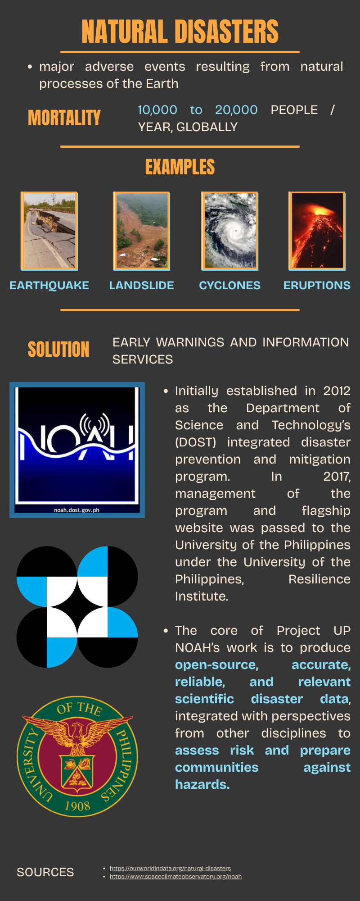

# 🔹 Activity 3 — Social Media Infographics & Project Documentation

> **Focus:** Visual Communication & Project Documentation

This activity involved creating informative and visually appealing infographics intended for social media platforms, as well as preparing project documentation. It focused on presenting information creatively, organizing important details, and communicating messages effectively through digital content.

---

### 🖼️ Activity Output

  

  📄 <a href="./FILES/Project%20Documentation.pdf">View Project Documentation (PDF)</a>

---

### 🩵 What Have I Learned?

I learned how to transform information into visually engaging and easy-to-understand infographics using appropriate graphics, colors, icons, and text arrangements. I also developed skills in organizing information, documenting project details, and maintaining accuracy and consistency in my work. One challenge I faced was fitting important information into a limited space while keeping the design attractive and readable, which I solved by shortening unnecessary text and organizing the content into sections. In the future, I can use these skills to create educational materials, awareness campaigns, and informative social media posts.

---
